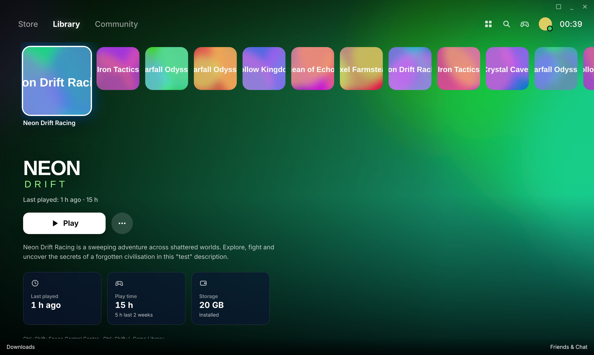
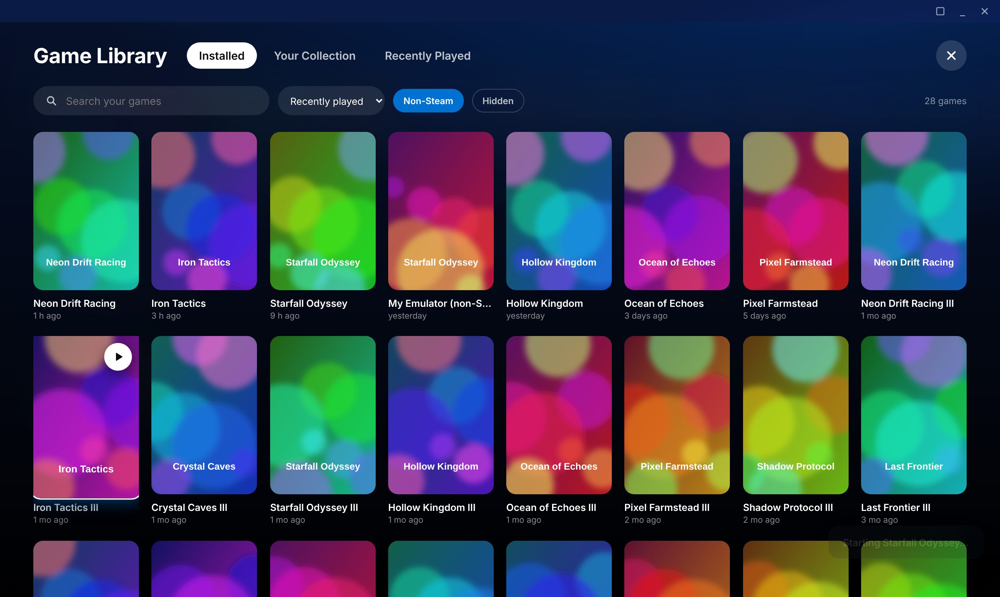
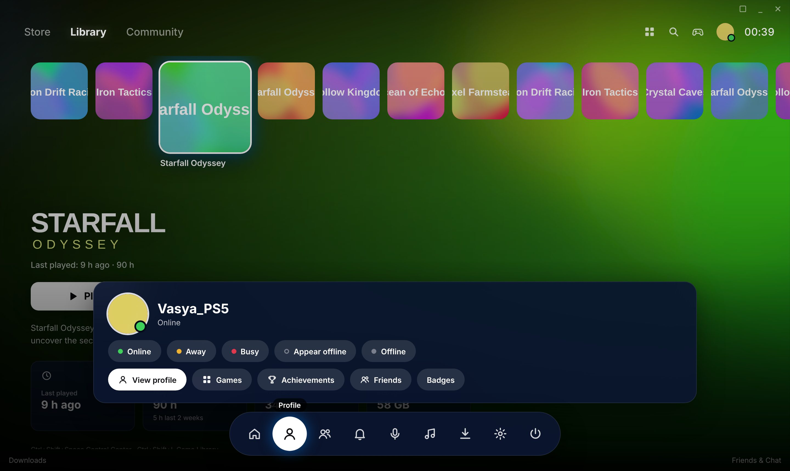
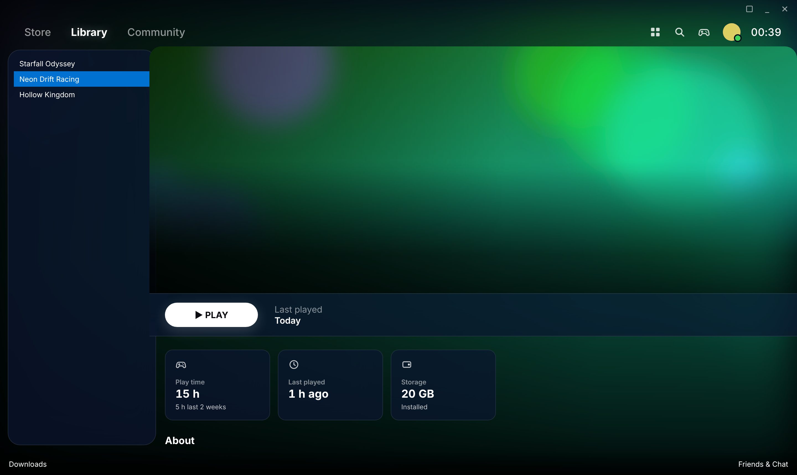
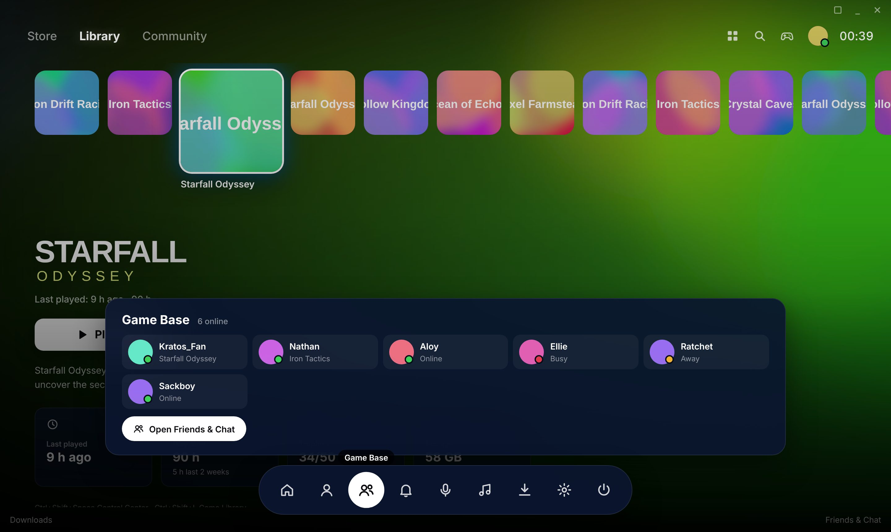

# PlayStation 5 — Millennium Theme for Steam

A PlayStation 5 style shell for the Steam desktop client, built for
[Millennium](https://steambrew.app/). Not just recoloured Steam: a PS5 **Home Screen** with your
real games, a **Game Library**, a **Control Center**, PS5 **game hubs**, a PSN-style profile,
glass panels and smooth motion — while every Steam function keeps working underneath.



> Unofficial fan project. Not affiliated with or endorsed by Sony Interactive Entertainment or
> Valve. "PlayStation" and "PS5" are trademarks of Sony Interactive Entertainment. No Sony logos
> or assets are included. Screenshots use placeholder game art.

**[⬇ Download the latest ZIP from GitHub Releases](https://github.com/Blackhagwag/PlayStation-5-Millennium-Theme/releases/latest)**

## Screenshots

| Game Library | Control Center |
|---|---|
|  |  |
| **Game hub** | **Game Base (friends)** |
|  |  |

## Features

- **PS5 Home Screen** — row of recently played games; the selected game's hero art fills the
  window and crossfades as you switch; logo, last played, play time, trophies, storage,
  description; **Play** really launches the game (`SteamClient.Apps.RunGame`), and becomes
  Stop / Cancel / Install like Steam's own button. ← → to switch, Enter to play.
- **Game Library** (`Ctrl+Shift+L`) — *Installed*, *Your Collection*, *Recently Played*;
  search, sort, Non-Steam / Hidden filters, covers, hover Play. Rendered in pages with lazy
  images, so thousands of games stay smooth.
- **Control Center** (`Ctrl+Shift+Space`) — Profile with status switcher, Game Base (online
  friends), Notifications, Voice Chat, Music, live Downloads, Settings, Power. Everything uses
  real Steam functions (`steam://` URLs and `SteamClient`), nothing is faked.
- **Game hub** — large art, PS5 white Play button, activity cards, About, screenshots
  (yours + store) with a lightbox. Steam's achievements, news and activity stay on the page.
- **Everywhere else** — PS5 top tabs with clock and avatar, glass game list, downloads page,
  friends & chat, menus, notifications, settings dialogs, and optional PS5 styling for the
  Store, Community and a PlayStation Network-style **profile** (avatar, level, games,
  achievements, friends).
- **Options** in Millennium → Themes → PlayStation 5: accent colour (5 presets or your own),
  background (game art / PS5 waves / black), blur, reduced motion, boot animation, clock
  format, home layout, store styling, theme language (English / Русский).

## Compatibility

| | |
|---|---|
| Millennium | current releases (themes in `<Steam>/millennium/themes/`, `skin.json` Patches + Conditions) |
| Steam | the current desktop client (new library UI). Windows and Linux |
| Sections | Library, Home, game pages, Downloads, Store, Community, Profile, Friends & Chat, menus, notifications, dialogs |
| Left untouched | Big Picture Mode and the in-game overlay (so games and the overlay can never break) |

The theme only adds CSS and one script to Steam's windows through Millennium. It does not
modify Steam's files, does not change login, purchases or downloads, and has no installer.

## Installation (manual, through Millennium)

No installer, no Node.js, no Python — just the ZIP.

1. Install [Millennium](https://docs.steambrew.app/users/getting-started/installation) if you
   haven't yet, and start Steam once.
2. Download **`PlayStation-5-Millennium-Theme-vX.Y.Z.zip`** from
   [Releases](https://github.com/Blackhagwag/PlayStation-5-Millennium-Theme/releases/latest).
3. Open Millennium's themes folder (the Themes page in Millennium's settings links to it in
   recent versions; otherwise open it yourself):
   - Windows: `C:\Program Files (x86)\Steam\millennium\themes\`
   - Linux: `~/.local/share/Steam/millennium/themes/` (or `~/.steam/steam/millennium/themes/`)
   - Older Millennium versions use `<Steam>/steamui/skins/` instead.
4. Extract the ZIP **into that folder**. You should end up with
   `themes/PlayStation-5-Millennium-Theme/skin.json` (one folder, `skin.json` directly inside it).
5. Back in **Millennium → Themes**, pick **PlayStation 5** and let Steam reload.
6. Optional: open the theme's settings (gear next to it) to choose accent, background,
   language and the rest.

**Updating:** delete the old `PlayStation-5-Millennium-Theme` folder, extract the new ZIP the same
way, reload Steam. **Removing:** pick another theme (or Default) and delete the folder.

## Shortcuts

| Key | Action |
|---|---|
| `Ctrl+Shift+Space` | Open / close Control Center |
| `Ctrl+Shift+L` | Open / close Game Library |
| `←` `→` | Switch games on Home (or sections in Control Center) |
| `Enter` | Play the selected game on Home |
| `Esc` | Close Control Center, Game Library or a screenshot |

## Development

```
skin.json            Millennium manifest: patches per window, options (Conditions)
css/root.css         colours editable in Millennium's Colors tab
css/shared.css       tokens, font, buttons, inputs, dialogs (all desktop windows)
css/main.css         main window: top bar, game list, home shelves, game page, downloads
css/components.css   the PS5 components built by the script
css/friends.css      friends & chat     css/menus.css   context menus
css/toasts.css       notifications      css/webkit/web.css  Store, Community, Profile
css/options/         one small file per option value
js/ps5.js            runtime for the main window (Home, Library, Control Center, game hub)
fonts/inter/         Inter variable font (OFL)
tests/               mock Steam window + Playwright checks (not shipped)
scripts/             validate.mjs, package.sh (not shipped)
```

How it works: Millennium injects the CSS/JS listed in `skin.json` into matching Steam windows
(by window title or class, e.g. `^Steam$` for the main window, `.friendsui-container` for chat)
and into store/community pages (by URL). `js/ps5.js` reads Steam's own stores
(`appStore`, `collectionStore`, `appDetailsStore`, `SteamUIStore`, `FriendStore`) and acts only
through Steam (`SteamClient.Apps.RunGame`, `SteamClient.Downloads`, `steam://…`).

Performance: one `MutationObserver` (on Steam's main panel) batched to one animation frame, a
2-second fallback tick that pauses while Steam is hidden, rebuilds only when the data actually
changes, lazy images, paged library grid, listeners released on close, and a full `destroy()`
on reload.

Checks (developer only, needs Node 18+ and Playwright):

```
node scripts/validate.mjs     # manifest, referenced files, CSS urls, JS syntax
node tests/run.mjs            # 40 checks against a mock Steam window
scripts/package.sh            # builds + verifies dist/PlayStation-5-Millennium-Theme-vX.Y.Z.zip
```

Releases: bump `version` in `skin.json`, add a section to `CHANGELOG.md`, push a `vX.Y.Z` tag (or
run the *Build & Release* workflow) — GitHub Actions validates, builds the ZIP, verifies it and
publishes the release with the ZIP attached.

Found something broken after a Steam update? Open an issue with a screenshot and your
Millennium version.

## License

MIT (code) · Inter font under SIL OFL 1.1. See [LICENSE](LICENSE).
